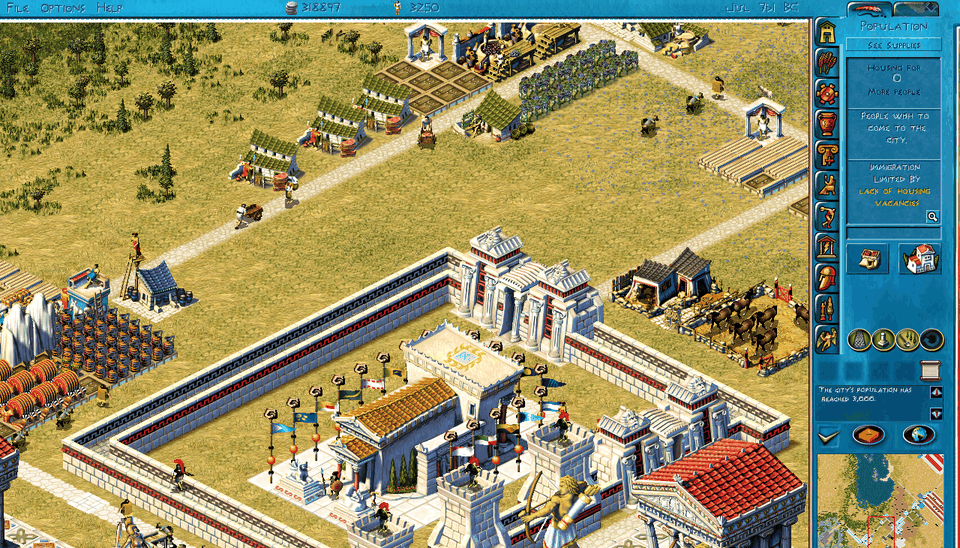
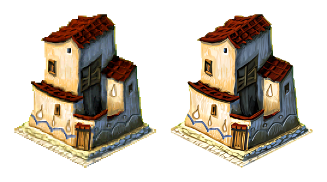
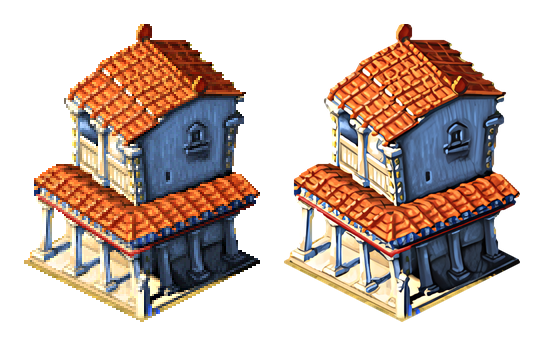

# OpenZeus

OpenZeus is an open-source re-implementation of Zeus: Master of Olympus (TM), written in Python. It plays the
original's open-play maps and campaigns. Its rules and numbers come from the original game's program, and they are
checked against runs of the original game.



The game has two parts. The simulation is plain Python with no graphics: it runs the city, and you can play and
test it from a terminal. A small web server runs the simulation and sends its state to a browser tab. The tab draws
it with WebGL and sends your clicks back. Python keeps the rules easy to read and change, and the client runs in any
browser with WebGL 2, with nothing to install.

The Python script also makes it very easy to modify the game with coding agents, to run it headless for simulation and testing (1 year of game's time can be simulated in 1 second), and for extension. Decoupling it from the graphics engine means anyone can build a graphics engine on top of it, however they please.

## Play

You need Python 3.14 or newer (saves use `zstd` module) and Chrome, or another browser with WebGL 2. You also need
the game's assets: its sprites, sounds and text. They are not in this repository (copyrighted). Install the Python packages with
`python3 -m pip install -r requirements.txt`, then get the assets one of two ways:

- **From your own copy of Zeus: Master of Olympus** (the GOG release is tested):

  ```
  python3 tools/assets.py build --game "PATH/TO/Zeus"
  ```

  `PATH/TO/Zeus` is the folder with Zeus.exe in it. The build makes everything except the hi-res sprites. For those,
  download the hi-res pack below and add `--hires pack --pack openzeus-assets-hires.zip`.

- **From the asset packs**, if you already own the game: download both packs from
  [openzeus.abiusx.com](https://openzeus.abiusx.com), then run

  ```
  python3 tools/assets.py install openzeus-assets-base.zip openzeus-assets-hires.zip
  ```

Then start the server and open the page:

```
python3 -m sim live
```

Open http://127.0.0.1:8765/play.html. You start on a new open-play city; the campaigns are on the main menu. Save
with File > Save. The game also autosaves every January and July, as the original does (Options can switch it off).
To keep a city in a file of your own, saved every few seconds, give its name: `python3 -m sim live saves/my-city.pkl`.

## Differences from the original

OpenZeus changes a few things on purpose. The docs mark each of these changes "ours": OpenZeus's behaviour where
it differs from the original. Most can be switched off in the Options menu of the bottom bar:

- The city keeps running while an info window, a message or the world map is open (instead of pause)
- Message windows close themselves after 10 seconds. When one closes, a gift from another city is accepted if it
  fits in your storage, and a city's request is accepted and sent if you have the goods.
- You can zoom, the window can be any size, and the sprites can be drawn in high resolution.
- A few bugs of the original are fixed. `data/fixes.json` lists them, and each one can be switched back.

## Hi-res sprites

The client can draw every sprite at twice the original size. Each sprite was upscaled four times with an ESRGAN
model (Remacri). In Options you turn them on or off per set: buildings, figures, terrain and the interface.

I suggest using the hires ones, they make the game much more beautiful, and need about 2 GB of VRAM.

Original on the left, hi-res on the right:




How they were made: docs/play/hires.md.

## Bugs

Report bugs as [GitHub issues](https://github.com/abiusx/openzeus/issues). Attach the save file, a screenshot, and
the steps that led to the bug. If you know what the original does in the same spot, say so.

## Contributing

The docs are in `docs/`; start at `docs/README.md`. `CLAUDE.md` is the guide for contributors and coding agents: the
layout, the rule that the original game decides every question, and how to check a change. `TODO.md` lists the open
work. Examples:

- floating debris at the sea entry, and the signs at the map's entry and exit points;
- beach tiles that block walkers;
- the original's random number generator, drawn in the original's order;
- the Poseidon expansion.

`docs/re/` describes the reverse-engineering evidence: the names we gave the original's functions, and the oracle,
which runs the original game and dumps its state to compare with ours.

## Legal

OpenZeus is not affiliated with or endorsed by the makers or owners of Zeus: Master of Olympus (TM). This repository holds none of the original's sprites, sounds, music or text. The asset packs are for people who already own the game. The code is under the MIT licence (LICENSE). The patch to the zeus-poseidon-arm64 emulator in `re/oracle/` is GPL, like that project.

## Related projects

- [zeus-poseidon-arm64](https://github.com/nic0lasm/zeus-poseidon-arm64): runs the original Zeus on Apple Silicon and
  Linux. Its emulator is the base of our oracle.
- [eZeus](https://github.com/MaurycyLiebner/eZeus): an independent C++ remake of Zeus and Poseidon.
